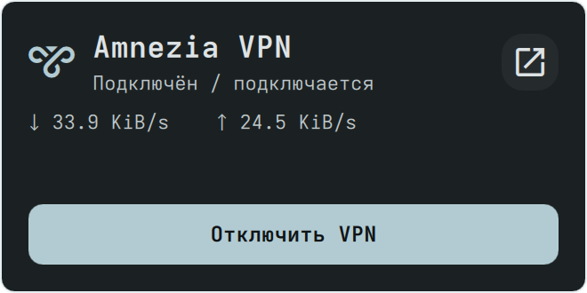

# Amnezia VPN widget for Serpantinum

[English](docs/README.en.md) · [Serpantinum by ilyamiro](https://github.com/ilyamiro/serpantinum) · [Amnezia VPN](https://github.com/amnezia-vpn/amnezia-client)

Виджет Amnezia VPN для рабочего стола **Serpantinum**. Устанавливается в **обычный каталог встроенных виджетов** и добавляется через штатный редактор: **Amnezia VPN**. Его можно перемещать, масштабировать и удалять так же, как часы или батарею.



## Возможности

- Подключение и отключение через настоящие команды значка Amnezia в трее.
- Открытие окна Amnezia и запуск приложения, если оно закрыто.
- Состояние из меню Amnezia, обновляемое по D-Bus и каждые две секунды.
- Скорость загрузки и отправки для интерфейсов Amnezia `amn0`, `amn1` и т. д.
- Цвета, шрифт и прозрачность темы Serpantinum; русский и английский интерфейс.
- Один общий процесс наблюдения для всех экземпляров виджета; при отсутствии видимых экземпляров он останавливается.

Виджет **не читает конфигурацию VPN, ключи, пароли, список серверов или журналы**, не делает запросов во внешнюю сеть и не вызывает `sudo`. Подключается профиль, который уже выбран в Amnezia. Сервер и протокол меняются в самом приложении.

## Установка

Требуются работающий Serpantinum, Amnezia VPN со значком в трее, Python 3.9+ и PyGObject/Gio. Проверено на **Serpantinum 2.2.13 (`bc63054`), Arch Linux, Hyprland**. Системные установки Serpantinum только для чтения и Nix store этим установщиком не изменяются.

PyGObject обычно уже установлен вместе с окружением. Если его нет:

```bash
# Arch Linux
sudo pacman -S python-gobject
# Debian / Ubuntu
sudo apt install python3-gi
```

Установка самого виджета — **без sudo**:

```bash
curl -fsSL https://raw.githubusercontent.com/bibibobo479/serpantinum-amnezia-widget/main/install.py | python3 -
```

Команда запускает установщик из репозитория. Для предварительной проверки скачайте [install.py](install.py), прочитайте его, затем выполните `python3 install.py`. Установщик скачивает четыре файла виджета, лицензию и уведомления из тега релиза `v1.0.0` и добавляет отмеченный блок в `WidgetRegistry.qml`. Исходная версия реестра сохраняется рядом как `WidgetRegistry.qml.before-amnezia`.

После установки:

1. Перезагрузите оболочку: `serpantinum reload`.
2. Откройте редактор виджетов Serpantinum.
3. Выберите **Amnezia VPN** и разместите карточку на рабочем столе.

Автоматически находятся пользовательские установки в `$XDG_DATA_HOME/serpantinum/src` или `~/.local/share/serpantinum/src`. Для другого расположения:

```bash
python3 install.py --serpantinum /путь/к/serpantinum/src/quickshell
```

Можно также скачать исходники репозитория и запустить `python3 install.py`: при наличии локального каталога `widget/` сеть не требуется.

## Что означает состояние

**«Подключён / подключается»** означает, что в нативном меню Amnezia разрешено отключение и запрещено подключение. Сама Amnezia использует одинаковые флаги меню для соединённого состояния, подключения, переподключения и отключения. Поэтому виджет **не выдаёт это за подтверждённый VPN-туннель или проверку доступности интернета**. Подробное состояние смотрите в окне Amnezia.

**«VPN отключён»** означает, что разрешена штатная команда подключения. Если пункты меню неизвестны или недоступны, виджет не угадывает команды по их номеру и предлагает открыть приложение.

Счётчики скорости относятся только к `amn*`. Для OpenVPN/Xray и интерфейсов с другими именами скорость может отсутствовать; подключение через меню продолжает работать. При обнулении счётчика или смене интерфейса старая скорость не переносится.

При клике разрешённость команды проверяется повторно: устаревшее состояние карточки не превращается в случайное обратное переключение. Кнопка блокируется на короткое время после команды. Это защита от повторного клика, а не индикатор успешного соединения.

## Обновление и удаление

Повторная установка обновляет файлы без повторной регистрации. Обновление самого Serpantinum может заменить реестр или удалить дополнение; после него при необходимости запустите установщик снова. Автоматически патчить оболочку в фоне виджет не пытается.

Для удаления сначала уберите карточки с рабочего стола через редактор, затем:

```bash
curl -fsSL https://raw.githubusercontent.com/bibibobo479/serpantinum-amnezia-widget/main/install.py | python3 - --uninstall
serpantinum reload
```

Удаление вырезает только отмеченный блок регистрации и собственные файлы. Позднейшие изменения реестра Serpantinum сохраняются; исходная резервная копия не накатывается поверх них. Настройки и соединение Amnezia не меняются.

## Разработка и тесты

```bash
python3 -m unittest discover -s tests -p test_core.py -v
AMNEZIA_TEST_PRIVATE_BUS=1 dbus-run-session -- python3 tests/test_dbus.py
```

Второй тест создаёт **отдельную D-Bus-шину и макет трея**. Он проверяет настоящие вызовы Gio/D-Bus, подключение, отключение, открытие, поток состояния и отказ устаревшим командам, не трогая реальный VPN. Первый проверяет локализацию меню, состояния, счётчики трафика, повторную установку и безопасное удаление. [Результаты проверки](docs/VALIDATION.md).

Основные файлы: `widget/AmneziaFace.qml` — карточка; `AmneziaService.qml` — общий процесс и кнопки; `amnezia.py` — D-Bus и счётчики Linux; `install.py` — интеграция в каталог.

## Лицензия и авторство

**AGPL-3.0-or-later**, copyright 2026 bibibobo479. Лицензия выбрана для совместимости с Serpantinum, который также распространяется под AGPL-3.0-or-later. [LICENSE](LICENSE), [NOTICE.md](NOTICE.md).

Serpantinum создан **Illia Miroshnichenko (ilyamiro)** и его участниками. Amnezia VPN принадлежит своему проекту и правообладателям. Это отдельное неофициальное дополнение; оно не является частью официального upstream Serpantinum и не означает одобрение авторов. Установка добавляет виджет в локальную копию оболочки.
